<div align="center">





<br/>


<br/>

<a href="https://github.com/Sadhin404/Projects/releases/tag/artistre-v1.9.2"></a>

**Four developers. One vision. Built with passion and innovation.**

</div>

---

## ✦ What is Artistre?

Artistre turns your phone into a **drawing tracer**. Pick any photo, and Artistre floats it over your **live camera** — place a sheet of paper under the phone, set the photo's opacity, lock it in place, and trace the lines right onto the paper. Portraits, anime, logos, lettering — if you can photograph it, you can draw it.

> *"Turn your imagination into art with Artistre."*

## 🎨 Features

<table width="100%">
<tr>
<td width="50%">

📷 **Live camera tracing**
Your photo floats over the real camera feed — trace straight onto the paper below

</td>
<td width="50%">

👻 **Opacity 5–100%**
Slide from a solid reference to a faint ghost — plus pinch-zoom, drag and two-finger rotation

</td>
</tr>
<tr>
<td width="50%">

🎚 **Pro adjustments**
Brightness, Contrast, Saturation and Black & White — every slider starts at 0, so your photo opens untouched, tuned with a liquid-glass selector

</td>
<td width="50%">

🖼 **4 drawing modes**
Original, Outline (edge detection), Grey and Invert — outlines are made for tracing

</td>
</tr>
<tr>
<td width="50%">

🔒 **Lock & grid**
Lock the photo so touches can't move it, and overlay a 3×3 grid drawn right on the picture

</td>
<td width="50%">

✂️ **Remove BG & Crop**
One tap lifts the paper-white background away; crop exactly the part you want to draw

</td>
</tr>
<tr>
<td width="50%">

💡 **Lightbox & torch**
Turn the screen into a lightbox for thin paper, or fire the torch in a dark room

</td>
<td width="50%">

🎥 **Timelapse record**
Record your whole drawing session as a 20× timelapse video

</td>
</tr>
<tr>
<td width="50%">

🌗 **Animated themes**
Dark and light themes with a sun-to-moon animated switch — your preference is remembered

</td>
<td width="50%">

✨ **A home that moves**
Animated 3D cards, a traced-by-a-pencil opening animation, and a one-page home — everything fits without scrolling

</td>
</tr>
</table>

## 🧠 How it works

```
Pick a photo
      │
      ▼
Camera opens — the photo floats over the live feed
      │
      ▼
Set opacity & position — pinch, drag, rotate, adjust
      │
      ▼
Lock it — then trace the lines onto your paper  ✓
```

## 📦 Versions

| Version | Status | Details |
|---|---|---|
| 📱 **Artistre for Android** | ✅ **Released — v1.9.2** | Native Android app (Java + Camera2, no ads, no account) · [Download the APK](https://github.com/Sadhin404/Projects/releases/tag/artistre-v1.9.2) |

## 📂 What's inside

```
Artistre/
├── assets/      · animated artwork for this README
└── README.md    · you are here
```

## 👨‍💻 About Us — the Team

**FCUB • CSE Final Year** — *Four developers. One vision. Built with passion and innovation.*

<div align="center">

<table width="100%">
<tr>
<td align="center" width="50%">
<br/>

<br/><br/><b>Sadhin Khan</b>
<br/>
<br/><br/><a href="https://www.facebook.com/share/1GRMfN9pwh"></a>&nbsp;<a href="https://www.instagram.com/sadhin.404"></a>&nbsp;<a href="https://github.com/Sadhin404"></a>
<br/><br/>
</td>
<td align="center" width="50%">
<br/>

<br/><br/><b>Ali Emam Rabby</b>
<br/>
<br/><br/><a href="https://www.facebook.com/share/1E3GyCanz2"></a>&nbsp;<a href="https://www.instagram.com/ali.emam.rabbi"></a>
<br/><br/>
</td>
</tr>
<tr>
<td align="center" width="50%">
<br/>

<br/><br/><b>Sristi Sorower</b>
<br/>
<br/><br/><a href="https://www.facebook.com/share/1C8fXfc2j3"></a>&nbsp;<a href="https://www.instagram.com/sristisorower"></a>
<br/><br/>
</td>
<td align="center" width="50%">
<br/>

<br/><br/><b>Meharab Hosen</b>
<br/>
<br/><br/><a href="https://www.facebook.com/share/1A4nXS2xHP"></a>&nbsp;<a href="https://www.instagram.com/hosen.meharab"></a>
<br/><br/>
</td>
</tr>
</table>

</div>

---

<div align="center">

*Artistre is built by a passionate team of innovators who believe technology should be powerful, simple, and beautiful. We craft experiences that inspire, empower, and connect people around the world.*

© 2026 Artistre • Crafted with ♥ by the Artistre team


</div>
