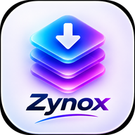

<div align="center">





<br/>


**Four developers. One vision. Built with passion and innovation.**

</div>

---

## ✦ About Zynox for Windows

Zynox is built by a passionate team of innovators who believe technology should be powerful, simple, and beautiful. We craft experiences that inspire, empower, and connect people around the world.

Zynox for Windows is the desktop twin of the [Android app](../Mobile%20Version): paste a link from YouTube, TikTok, Facebook, Instagram or 1000+ other sites, pick exactly the quality you want, and the file lands in your `Downloads/Zynox` folder — with live progress (percent, MB, speed, ETA), pause/resume, and a browser extension that sends the video you're watching straight into the app.

> *"Our mission is simple — create technology that makes life easier, faster, and more enjoyable for everyone."*

## ⚡ Features

- 🎬 **Up to 8K video** — pick the exact quality, Video | Audio | Photos side by side
- 🎵 **MP3 at 320 kbps** — one-tap audio extraction at maximum quality
- 📱 **The phone's download system, A–Z** — the exact pipeline that made Zynox Android flawless (a single yt-dlp engine call with yt-dlp's own default clients — no client pinning, no detours), ported to Windows unchanged
- ⚡ **QuickJS challenge solving** — a bundled QuickJS runtime (`qjs.exe`), the same trick the Android library uses, so videos that report *"This video is not available"* in other tools simply download
- 🚀 **Innertube fast fetch** — YouTube clients raced in parallel, first playable result wins, full quality list in seconds
- 💧 **TikTok without watermark** — clean downloads via the tikwm route first, plus photo-post support
- 🧩 **Browser extension** — *Zynox Download Helper* for Chrome/Brave: the popup grabs the video playing right now (YouTube / Instagram / Facebook auto-detect, editable link; TikTok by paste) and opens it in the app through the `zynox://` protocol
- ⏸ **Pause & resume** — IDM-style segmented progress bar, partial files kept and resumed
- 🔔 **Download-complete dialog** — Open / Open folder / Close, with the saved path and size
- 🔐 **Private video support** — optional Facebook / Instagram connection for private videos (cookies stay on your PC)
- 🔄 **Self-updating engine** — the bundled yt-dlp engine checks for updates daily, silently
- 📂 **Files tab** — real thumbnails for everything you download, one-click delete to the Recycle Bin
- 🖥 **Proper Windows app** — NSIS installer (per-user, no admin), Desktop + Start Menu shortcuts, single instance, tray support, dark glass design

## 🧠 How it works

```
Browser extension  /  paste a link
        │
        ▼
  Fetch — Innertube race (ANDROID_VR / ANDROID / IOS in parallel)
        │   first playable wins · engine fetch fallback (EJS solver)
        ▼
  Format picker — Video | Audio | Photos, exact itags
        │
        ▼
  Download — ONE yt-dlp engine call (the phone's v4 system)
        │   QuickJS solves YouTube's JS challenges
        │   audio: fresh direct stream → MP3 320, engine fallback
        ▼
  Downloads/Zynox  ✓
```

## 🗂 Project structure

```
PC Version/
├── electron/
│   ├── main.cjs          · engine orchestration, downloads, zynox:// protocol, tray
│   └── preload.cjs       · renderer bridge
├── src/
│   ├── App.jsx           · UI — Home / Downloads / Files / About / Settings
│   ├── main.jsx
│   ├── styles.css
│   └── assets/           · team photos (binary assets, kept in the working tree)
├── extension/            · "Zynox Download Helper" (Chrome / Brave, MV3)
│   ├── manifest.json
│   ├── content.js        · current-video link resolver + app launcher
│   ├── popup.html · popup.js
│   └── icons/            · extension icons (binary assets)
├── bin/                  · yt-dlp.exe · ffmpeg.exe · qjs.exe (see Building)
├── installer.nsi         · hand-written NSIS installer script
├── index.html · vite.config.js · package.json
└── README.md
```

## 🔨 Building

```bash
npm install
npm run build            # Vite → dist/

# Package the app (bin/ must contain yt-dlp.exe, ffmpeg.exe, qjs.exe)
npx electron-packager . Zynox --platform=win32 --arch=x64 --out=release --extra-resource=bin --icon=assets/icon.ico

# Compile the installer with NSIS (makensis installer.nsi)
```

Engine binaries for `bin/` (not committed — they're large third-party tools):

- `yt-dlp.exe` — from the [yt-dlp releases](https://github.com/yt-dlp/yt-dlp/releases)
- `ffmpeg.exe` — a static Windows build (e.g. gyan.dev)
- `qjs.exe` — QuickJS from the [quickjs-ng releases](https://github.com/quickjs-ng/quickjs/releases) (v0.18.0, `qjs-windows-x86_64.exe`)

Notes:

- The app is **unsigned**, so Windows SmartScreen shows a one-time prompt on first install: **More info → Run anyway**.
- Image assets (`assets/icon.ico`, `src/assets/*.jpg`, `extension/icons/*.png`) are binaries and live in the working tree; the team photos are the same images already in this repository under `Mobile Version/`.

## 📥 Download

Get the installer and the extension from the [**Zynox PC v8.3.0 release**](https://github.com/Sadhin404/Projects/releases/tag/zynox-pc-v8.3.0):

- **Zynox-Setup-8.3.0.exe** — run it, done. Requires Windows 10/11 (64-bit).
- **Zynox-Extension.zip** — unzip, open `chrome://extensions`, enable **Developer mode**, **Load unpacked**, pick the folder. Then reload your video tabs.

## 👨‍💻 The Minds Behind Zynox

**FCUB • CSE Final Year** — *Four developers. One vision. Built with passion and innovation.*

<div align="center">

<table width="100%">
<tr>
<td align="center" width="50%">
<br/>

<br/><br/><b>Sadhin Khan</b>
<br/>
<br/><br/><a href="https://www.facebook.com/share/1GRMfN9pwh"></a>&nbsp;<a href="https://www.instagram.com/sadhin.404"></a>&nbsp;<a href="https://github.com/Sadhin404"></a>
<br/><br/>
</td>
<td align="center" width="50%">
<br/>

<br/><br/><b>Ali Emam Rabby</b>
<br/>
<br/><br/><a href="https://www.facebook.com/share/1E3GyCanz2"></a>&nbsp;<a href="https://www.instagram.com/ali.emam.rabbi"></a>
<br/><br/>
</td>
</tr>
<tr>
<td align="center" width="50%">
<br/>

<br/><br/><b>Sristi Sorower</b>
<br/>
<br/><br/><a href="https://www.facebook.com/share/1C8fXfc2j3"></a>&nbsp;<a href="https://www.instagram.com/sristisorower"></a>
<br/><br/>
</td>
<td align="center" width="50%">
<br/>

<br/><br/><b>Meharab Hosen</b>
<br/>
<br/><br/><a href="https://www.facebook.com/share/1A4nXS2xHP"></a>&nbsp;<a href="https://www.instagram.com/hosen.meharab"></a>
<br/><br/>
</td>
</tr>
</table>

</div>
---

<div align="center">

© 2026 Zynox • Crafted with ♥ by Team Zynox


</div>
