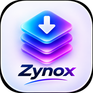

<div align="center">





<br/>


<br/>

<a href="https://github.com/Sadhin404/Projects/releases/tag/zynox-mobile-v81"></a>

**Four developers. One vision. Built with passion and innovation.**

</div>

---

## ✦ What is Zynox?

Zynox is a fast, modern **download manager** built by Team Zynox — four final-year CSE students at the First Capital University of Bangladesh. Paste a link from **YouTube, TikTok, Facebook, Instagram or 1000+ other sites**, pick exactly the quality you want, and the file lands in your `Downloads/Zynox` folder — with live progress, pause/resume, and background downloading that keeps working while you use other apps.

> *"Our mission is simple — create technology that makes life easier, faster, and more enjoyable for everyone."*

## ⚡ Features

<table width="100%">
<tr>
<td width="50%">

🎬 **Up to 8K video**
Pick the exact quality — 360p to 8K, exactly the format you chose

</td>
<td width="50%">

🎵 **MP3 at 320 kbps**
One-tap audio extraction at maximum quality

</td>
</tr>
<tr>
<td width="50%">

🚀 **Fast fetch**
YouTube formats raced across multiple clients in parallel — the full quality list in seconds

</td>
<td width="50%">

💧 **TikTok without watermark**
Clean video downloads, plus photo-post support

</td>
</tr>
<tr>
<td width="50%">

⏸ **Pause & resume**
Partial files are kept and resume right where they stopped — even from the notification

</td>
<td width="50%">

🔔 **Smart notifications**
Live progress, a standalone *Paused* notification with Resume, a gentle buzz on finish

</td>
</tr>
<tr>
<td width="50%">

🔐 **Private video support**
Optional Facebook / Instagram login, stored encrypted (Android Keystore, AES-GCM)

</td>
<td width="50%">

🔄 **Self-updating engine**
The download engine checks for updates daily, so downloads keep working as sites change

</td>
</tr>
<tr>
<td width="50%">

🌙 **Dark violet design**
Animated splash, ambient light background, light & dark themes

</td>
<td width="50%">

📂 **Built-in file manager**
Everything you download, organised in one place

</td>
</tr>
</table>

## 🧠 How it works

```
Paste a link (or share it to Zynox)
        │
        ▼
  Fast fetch — clients raced in parallel, engine fallback
        │
        ▼
  Pick your format — Video | Audio | Photos, exact quality
        │
        ▼
  Background download service — pause / resume, live progress
        │
        ▼
  Saved to Downloads/Zynox  ✓
```

## 📦 Versions

| Version | Status | Details |
|---|---|---|
| 📱 **Mobile Version** | ✅ **Released — v81** | Android app (Java + yt-dlp engine). Full source in [`Mobile Version/`](https://github.com/Sadhin404/Projects/tree/main/Zynox%20Download%20Manager/Mobile%20Version) · [Download the APK](https://github.com/Sadhin404/Projects/releases/tag/zynox-mobile-v81) |
| 🖥 **PC Version** | 🚧 In testing | Windows app (Electron + React) — the same download system as the phone app. Source lands in `PC Version/` when testing completes |

## 📂 What's inside

```
Zynox Download Manager/
├── Mobile Version/   · Android source, build scripts and full README
├── PC Version/       · Windows source (arrives after testing)
└── README.md         · you are here
```

## 👨‍💻 Team Zynox

**FCUB • CSE Final Year** — *Four developers. One vision. Built with passion and innovation.*

<div align="center">

<table width="100%">
<tr>
<td align="center" width="50%">
<br/>

<br/><br/><b>Sadhin Khan</b>
<br/>
<br/><br/><a href="https://www.facebook.com/share/1GRMfN9pwh"></a>&nbsp;<a href="https://www.instagram.com/sadhin.404"></a>&nbsp;<a href="https://github.com/Sadhin404"></a>
<br/><br/>
</td>
<td align="center" width="50%">
<br/>

<br/><br/><b>Ali Emam Rabby</b>
<br/>
<br/><br/><a href="https://www.facebook.com/share/1E3GyCanz2"></a>&nbsp;<a href="https://www.instagram.com/ali.emam.rabbi"></a>
<br/><br/>
</td>
</tr>
<tr>
<td align="center" width="50%">
<br/>

<br/><br/><b>Sristi Sorower</b>
<br/>
<br/><br/><a href="https://www.facebook.com/share/1C8fXfc2j3"></a>&nbsp;<a href="https://www.instagram.com/sristisorower"></a>
<br/><br/>
</td>
<td align="center" width="50%">
<br/>

<br/><br/><b>Meharab Hosen</b>
<br/>
<br/><br/><a href="https://www.facebook.com/share/1A4nXS2xHP"></a>&nbsp;<a href="https://www.instagram.com/hosen.meharab"></a>
<br/><br/>
</td>
</tr>
</table>

</div>

---

<div align="center">

*Zynox is built by a passionate team of innovators who believe technology should be powerful, simple, and beautiful. We craft experiences that inspire, empower, and connect people around the world.*

© 2026 Zynox • Crafted with ♥ by Team Zynox


</div>
